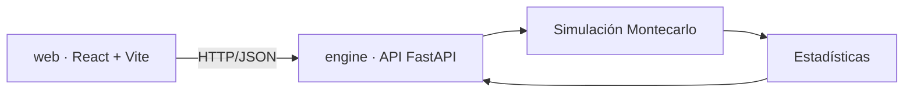

# Argentum — Arquitectura del MVP

**Estado:** propuesta, no implementada. Alcance y criterios de aceptación en [MVP.md](MVP.md). Visión futura en [CONTEXT.md](CONTEXT.md).

## 1. Forma general



Un solo usuario, en `localhost`, sin autenticación, sin base de datos y sin despliegue remoto. El escenario se exporta e importa como JSON.

La separación no es ceremonia: el motor tiene que poder testearse sin interfaz, ejercitar invariantes contables y sobrevivir a un cambio de UI. Ese es el requisito de "Core reutilizable" de MVP.md §2.

## 2. Modelo de datos

### Entrada — Escenario

Serializable, versionado, sin lógica. Es lo único que el usuario configura.

| Campo | Contenido |
|---|---|
| `version` | Versión del formato, para poder migrar escenarios guardados. |
| `patrimonio` | Saldos iniciales en ARS y en USD, más deuda. |
| `horizonte` | Cantidad de años a simular. |
| `ingresos` | Lista de tramos: desde, hasta, monto mensual, crecimiento real anual. |
| `gastos` | Lista de tramos: desde, hasta, monto mensual, crecimiento real anual. |
| `deudas` | Saldo, tasa, plazo. |
| `asignacion` | Proporción destinada a USD por año, o una regla simple. |
| `procesos` | Parámetros de inflación, retorno real ARS, retorno real USD y tipo de cambio. |
| `meta` | Monto objetivo, moneda, año. |
| `semilla`, `replicas` | Reproducibilidad y precisión. |

### Estado — lo que el motor acumula por año

Efectivo e inversiones en cada moneda, deuda, patrimonio neto nominal y patrimonio neto real.

## 3. Identidad del modelo

Este es el punto donde un modelo de dos monedas se rompe si no se fija antes de escribir código.

Se modela en **términos reales** y se reconstruye el nominal al final:

- `retorno real ARS = retorno nominal ARS − inflación ARS`
- `FX real = variación nominal del FX − (inflación ARS − inflación USD)`
- `nominal = real × inflación acumulada`

Si se sortean retornos nominales, inflación y FX de forma independiente, los tres se contradicen entre sí y el resultado deja de tener sentido económico. Fijar la identidad primero evita el doble conteo.

## 4. Contrato motor ↔ interfaz

Un único endpoint en el MVP:

```
POST /simulate
  body: { escenario }
  200:  { resumen, percentiles, trayectorias_muestra[], prob_meta, metadatos }
```

`metadatos` incluye `seed`, `replicas`, `version_modelo` y `run_id`. Sin eso no hay reproducibilidad demostrable, que es un requisito de MVP.md §5.

`trayectorias_muestra` es una muestra acotada (unas decenas), no las 1.000 trayectorias completas: mandar todo el volumen por HTTP no aporta nada que el usuario pueda leer.

## 5. Estructura del repositorio

```
argentum/
├── docs/                 MVP, contexto y esta arquitectura
├── assets/branding/      SVG y paleta existentes
├── engine/               Python
│   ├── pyproject.toml
│   ├── src/argentum/
│   │   ├── scenario.py   modelo de entrada y validación
│   │   ├── processes.py  inflación, retornos, FX, imprevistos
│   │   ├── simulate.py   Montecarlo y semillas
│   │   ├── stats.py      percentiles, probabilidad de meta, riesgo
│   │   └── api.py        FastAPI
│   └── tests/            invariantes A1-A6
└── web/                  React + Vite
    └── src/
```

## 6. Riesgos conocidos

| Riesgo | Tratamiento en el MVP |
|---|---|
| El tipo de cambio es el proceso más difícil de calibrar. | Volatilidad fija documentada como supuesto, sin calibración histórica. Se declara en el reporte. |
| Tres runtimes (Python, Node, navegador) y tres toolchains. | El contrato HTTP es la única frontera; cada lado se testea solo. |
| 1.000 réplicas estiman mal las colas. | Los percentiles extremos se reportan con su error, o se sube `replicas` explícitamente. |
| Sin persistencia. | Export/import de escenario en JSON; no hay cuentas de usuario. |

## 7. Fuera de alcance

Quant, Optimize y Business, backtesting bursátil, trading automático, optimización de carteras, autenticación, persistencia y despliegue remoto. Ver MVP.md §6.
