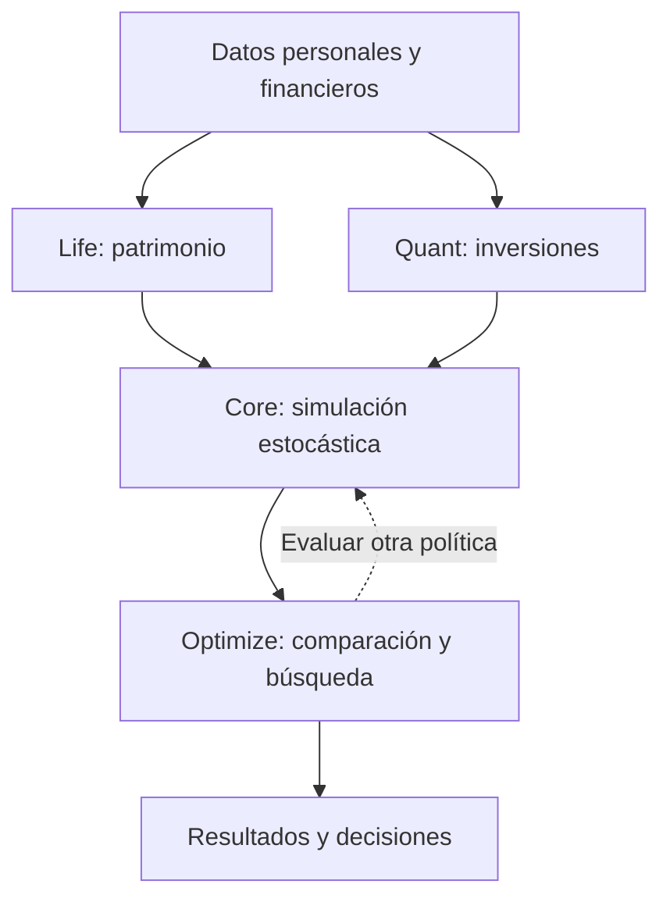
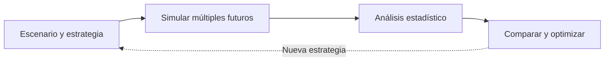

# Argentum

### Simulación y optimización del crecimiento patrimonial

`Proyecto final de Simulación` · `Contexto técnico y académico` · `v0.4`

**Alcance de este documento:** la visión completa del proyecto a futuro, no la primera versión. Lo que se construye ahora está en [MVP.md](MVP.md); todo lo de aquí es dirección y fundamento, no compromiso de entrega.

> **Objetivo:** desarrollar una plataforma que permita simular, comparar y optimizar decisiones financieras personales bajo incertidumbre, buscando aumentar el patrimonio real a largo plazo dentro de límites de riesgo aceptables.

## 1. ¿Qué vamos a construir?

Argentum combina **LifeCapital** (planificación patrimonial), **QuantRisk** (investigación cuantitativa de inversiones) y un motor de optimización. La planificación patrimonial será el núcleo del proyecto: se simularán múltiples futuros posibles considerando ingresos, gastos, ahorro, inversiones, deudas, inflación e imprevistos.

El propósito es evaluar qué decisiones favorecen el crecimiento económico personal, qué riesgos implican y qué probabilidad existe de alcanzar determinados objetivos financieros. No se garantiza rentabilidad ni superar al mercado.

## 2. Componentes

| Módulo | Responsabilidad |
|---|---|
| **Argentum Life** | Simular el patrimonio, ahorro, gastos, deudas, liquidez y objetivos financieros. |
| **Argentum Quant** | Analizar inversiones, simular rendimientos, realizar backtesting y comparar estrategias y riesgos. |
| **Argentum Core** | Motor matemático: números pseudoaleatorios, distribuciones, escenarios, evolución temporal y estadísticas. |
| **Argentum Optimize** | Buscar estrategias favorables de ahorro, inversión y asignación de capital según objetivos y restricciones. |
| **Argentum Business** | Evaluar emprendimientos y nuevas fuentes de ingresos (ampliación futura). |

## 3. Funcionamiento

El modelo será dinámico, abierto y estocástico, inicialmente de tiempo discreto.

| Elemento | Ejemplos |
|---|---|
| Entradas | Capital inicial, ingresos, gastos, activos, deudas, horizonte y metas. |
| Estados | Efectivo, inversiones, deuda y patrimonio neto. |
| Flujos | Ingresos, consumo, aportes, retiros, rendimientos e intereses. |
| Incertidumbre | Retornos, inflación, gastos extraordinarios y cambios laborales. |
| Decisiones | Tasa de ahorro, asignación de activos, rebalanceo y reserva de liquidez. |
| Resultados | Patrimonio real futuro, percentiles, probabilidad de alcanzar metas, riesgo de pérdida y falta de liquidez. |

El patrimonio neto se calculará como activos menos pasivos. Se distinguirán valores reales y nominales; las transferencias internas no crearán patrimonio. La simulación evalúa alternativas y el optimizador realiza la búsqueda.

## 4. Contenidos de la materia aplicados

| Fuente | Aplicación en Argentum |
|---|---|
| Cap. 1 — Introducción y Montecarlo | Modelización, réplicas, verificación, validación y sensibilidad. |
| Cap. 2 — Números pseudoaleatorios | Semillas, reproducibilidad y pruebas de uniformidad e independencia. |
| Cap. 3 — Aplicaciones | Estimación de probabilidades financieras y precisión según número de corridas. |
| Cap. 4 — Caminantes al azar | Modelos estocásticos de precios o rendimientos. |
| Cap. 5 — Administración de la producción | Muestreo de distribuciones empíricas y comparación de alternativas. |
| Archivo 6 — Cadenas de Markov | Transiciones entre regímenes de mercado o estados laborales. |
| Archivo 7 — Dinámica de sistemas | Niveles, flujos, retroalimentación, retardos y método de Euler cuando corresponda. |
| Taller — Optimización de lotes | Referencia metodológica para evaluar estrategias; no se trasladará directamente el modelo de inventarios. |

Se priorizarán Montecarlo, números pseudoaleatorios, dinámica patrimonial y análisis estadístico. Los demás modelos se incorporarán cuando los datos y supuestos lo justifiquen.

## 5. Validación y alcance inicial

La visión completa del proyecto incluirá el motor de simulación patrimonial, análisis de inversiones acotado, comparación y optimización de estrategias e interfaz de experimentación. Se documentarán el modelo matemático, los experimentos reproducibles y sus conclusiones.

La validación incluirá datos históricos cuando estén disponibles, pruebas de reproducibilidad e invariantes contables, evaluación fuera de muestra, comparación con benchmarks y costos, error de Montecarlo, análisis de sensibilidad y pruebas de estrés. Las estrategias candidatas incluyen Buy & Hold, DCA y rebalanceo; su selección definitiva queda pendiente.

**Estado:** nombre y enfoque híbrido confirmados. Aprobación docente, datos, ecuaciones, algoritmos, tecnologías y alcance definitivo pendientes. Business y ejecución automática de operaciones quedan fuera del alcance inicial. Aún no existen resultados empíricos validados.
