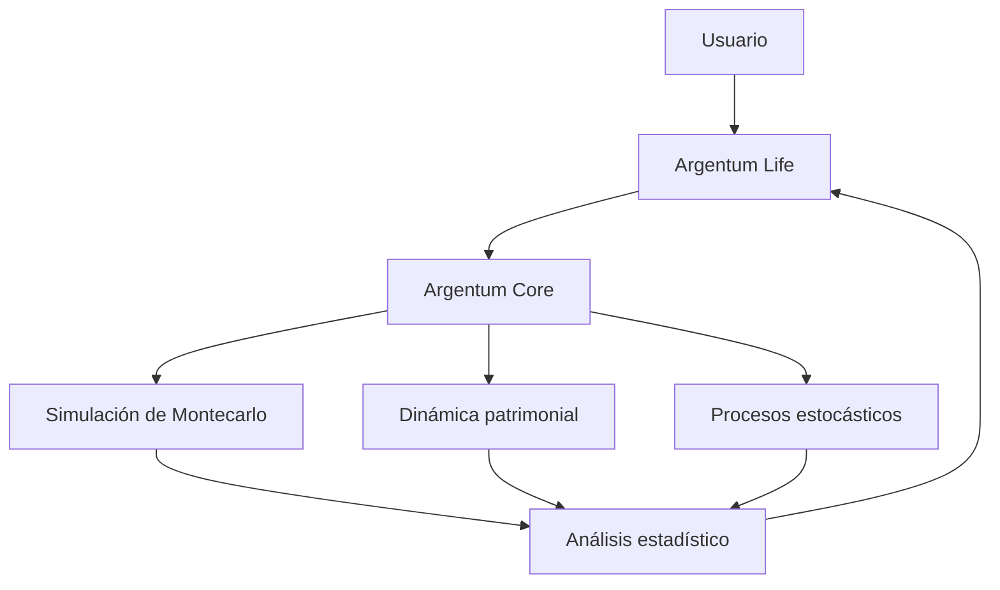

# Argentum — MVP

> Plataforma de simulación financiera personal y planificación patrimonial bajo incertidumbre.

**Alcance de este documento:** la primera versión, la que se construye ahora. Quant, Optimize y Business no forman parte de esta entrega. La visión completa del proyecto a futuro está en [CONTEXT.md](CONTEXT.md) y no es un compromiso de este MVP.

## 1. Objetivo

Desarrollar una herramienta que permita simular la evolución económica de una persona, comparar decisiones financieras y estimar la probabilidad de alcanzar objetivos patrimoniales a largo plazo.

El sistema no busca predecir el mercado ni garantizar rentabilidad, sino evaluar alternativas y riesgos bajo supuestos explícitos.

## 2. Componentes

| Componente | Responsabilidad |
|---|---|
| **Argentum Life** | Configuración de la situación financiera personal, objetivos, escenarios y visualización de resultados. |
| **Argentum Core** | Motor interno de simulación matemática, generación de escenarios y análisis estadístico. |

Core será un componente interno reutilizable; no requiere un servicio independiente.

## 3. Funcionalidades del MVP

- Configurar patrimonio inicial, ingresos, gastos, ahorros, deudas e inversiones.
- Definir objetivos financieros y horizonte temporal.
- Modelar inflación, rendimientos, variaciones salariales y gastos imprevistos.
- Simular múltiples trayectorias patrimoniales y comparar decisiones de ahorro, gasto e inversión.
- Visualizar patrimonio real y nominal, percentiles, probabilidad de alcanzar objetivos y riesgo de insuficiencia de fondos.

## 4. Fundamentos de Simulación

| Material de la materia | Aplicación propuesta |
|---|---|
| Introducción a la simulación | Modelización, experimentación, verificación y validación. |
| Números pseudoaleatorios | Generación reproducible de escenarios mediante semillas. |
| Aplicaciones de la simulación | Estimación de probabilidades mediante frecuencias de resultados. |
| Caminantes al azar | Modelado estocástico de precios o rendimientos de inversiones. |
| Administración de la producción / Montecarlo | Muestreo de distribuciones y comparación de alternativas. |
| Cadenas de Markov | Transiciones entre estados laborales o económicos, si los datos justifican el modelo. |
| Dinámica de sistemas | Acumulación de patrimonio, flujos monetarios y retroalimentación del interés compuesto y la deuda. |

## 5. Experimentación y validación

Cada corrida representará una trayectoria financiera posible. Se realizarán múltiples réplicas para estimar distribuciones de resultados, comparar escenarios y analizar la sensibilidad de los parámetros.

Se verificarán los balances financieros, la reproducibilidad y la convergencia de las estimaciones. Se utilizarán datos reales cuando estén disponibles y se documentarán los supuestos, la incertidumbre y las limitaciones del modelo.

## 6. Límites del MVP

Quedan fuera de esta versión Argentum Quant, Optimize y Business, el backtesting bursátil, el trading automático y la optimización automática de carteras. Life incluirá únicamente el modelado de rendimientos necesario para la planificación patrimonial.

Esos módulos pertenecen al horizonte descrito en [CONTEXT.md](CONTEXT.md); no son alcance del MVP ni se diseñan para soportarlos en esta etapa.

**Resultado esperado:** una aplicación funcional de simulación financiera personal, con un motor matemático reutilizable y resultados interpretables. El alcance académico deberá ser aprobado por el profesor; los modelos y parámetros específicos se definirán durante la investigación.

## 7. Decisiones de diseño del MVP

| Decisión | Elección | Consecuencia |
|---|---|---|
| Moneda | Mixto ARS/USD con tipo de cambio estocástico | El estado del modelo incluye saldos en ambas monedas y una serie de FX sorteada por año. |
| Producto | Web app local | Motor y presentación separados, con un contrato HTTP entre ambos. |
| Stack | Motor en Python, interfaz en React | Dos runtimes y dos toolchains; el motor queda reutilizable y testeable sin UI. |
| Réplicas | 1.000 por defecto, configurable | Error de Montecarlo de 2-3 puntos en probabilidades. Se sube cuando haga falta precisión en las colas. |

### Criterios de aceptación

Un criterio se considera cumplido solo si un test automático lo verifica.

| ID | Regla |
|---|---|
| A1 | Sin flujos y con retornos forzados a cero, el patrimonio final es igual al inicial (tolerancia 1e-9). |
| A2 | Misma semilla y mismo escenario producen resultados idénticos, corrida tras corrida. |
| A3 | Al multiplicar las réplicas por 10, el error de la media estimada baja aproximadamente por raíz de 10. |
| A4 | Una transferencia interna entre ARS y USD, valuada al mismo tipo de cambio, no altera el patrimonio neto total. |
| A5 | La probabilidad estimada de alcanzar la meta está en [0,1] y decrece al aumentar el monto de la meta. |
| A6 | El resultado real es igual al nominal deflactado por la inflación acumulada de esa misma trayectoria. |

Los criterios A1, A4 y A6 son invariantes contables: son la red que detecta un error de modelado que las estadísticas no muestran.
